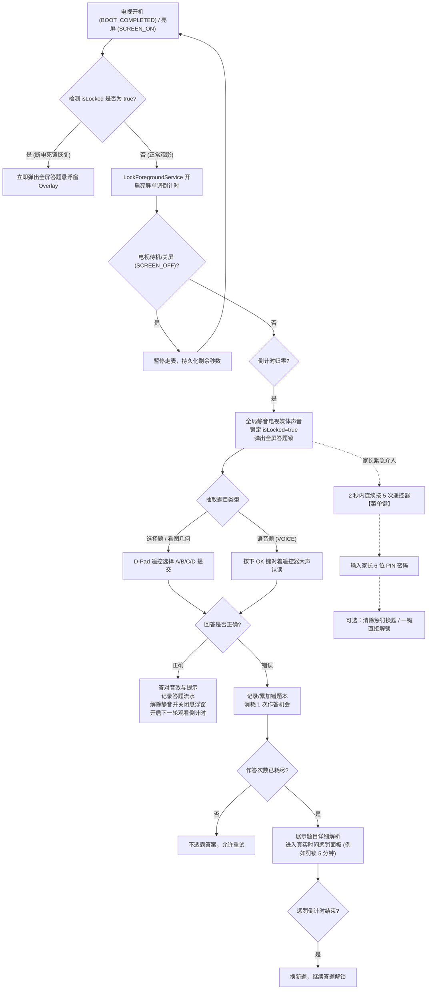

# XiaomiCoreService - 小米电视防沉迷强制答题锁系统

<p align="center">
  
</p>

<p align="center">
  <strong>专为小米电视及 Android TV / 电视盒子量身打造的高强度防沉迷与强制学习干预系统</strong>
</p>

<p align="center">
  
  
  
  
  
  
  
</p>

---

## 📖 项目简介

**XiaomiCoreService**（小米电视防沉迷核心守护服务）是一款针对家庭客厅大屏场景深度定制的**系统级防沉迷与强制答题锁**应用。主要目标机型为 **小米电视4A 65英寸** 以及市面上绝大部分主流 Android 智能电视与电视盒子。

针对未成年人使用电视常见的“超时沉迷”、“频繁切软件逃逸”、“拔掉插头重启电视绕过防沉迷”、“进入设置强制卸载”等典型逃避手段，本项目构建了**四重系统级防逃逸防御链路**、**纯单调时钟亮屏倒计时**、**断电死锁自愈机制**、**全屏阻断伴随硬件级全局媒体静音**以及**多模态答题学习闭环（4选项单选/看图几何/幼儿识物/大屏语音认读）**。

---

## 🌟 核心特性与设计亮点

### 1. 🛡️ 四重系统级防逃逸与断电死锁
- **断电死锁保证（Anti-Reboot Deadlock）**：锁屏状态与答题进度实时同步落盘（`commit()` 写入持久存储）。当电视被强行拔电源、关机或重启时，开机广播（`BOOT_COMPLETED`）及亮屏检测在系统启动 **5 秒内立刻恢复全屏锁定**，彻底杜绝“拔插头重启解万难”。
- **无障碍服务全局监控（`TvAccessibilityService`）**：
  - 拦截遥控器常用逃逸按键：`Home` 键、`Back` 键、`App Switch`（多任务切换）、`Settings`（设置键）、`TV/TV_Input`（信号源切换）等。
  - 实时监控顶层窗口，一旦检测到试图打开系统设置（`com.android.settings`、`com.xiaomi.mitv.settings` 等）或系统安装卸载器，**毫秒级弹出 6 位家长密码锁拦截**。
- **设备管理器防卸载（`TvDeviceAdminReceiver`）**：激活 Android 设备管理员权限（Device Administrator），阻断任何通过常规方式停用或卸载应用的行为。
- **家长控制中心入口鉴权**：进入 `MainActivity` 必须通过 6 位家长数字密码验证，严防孩子自行修改使用时长或关闭守护。

### 2. 📺 全屏顶层覆盖与媒体声道静音
- **最高层级全屏悬浮窗（`TYPE_APPLICATION_OVERLAY`）**：采用 `WindowManager` 原生顶层挂载，层级超越所有视频播放器与第三方桌面，保证锁屏画面无死角全覆盖。
- **全局媒体硬件级静音（Global Media Mute）**：锁屏时强占 `AudioFocus` 并将电视媒体声道（`STREAM_MUSIC`）直接静音，彻底消除背景播放器偷跑声音的现象；答题解锁后自动无缝还原原音量。

### 3. 🎯 100% 电视遥控器（D-Pad）与 65 英寸 4K 巨幕视效
- **零溢出焦点边距标准（Zero-Overflow Focus Margin Standard）**：针对 65 英寸 4K 巨幕在客厅 2.5m~3.5m 视距下的观看体验，所有获焦控件均采用内嵌发光光效或预留 8dp 安全边距，父级容器部署 `clipChildren="false"`，杜绝焦点卡边、截断或破坏卡片圆角。
- **高对比焦点光标动画**：遥控器方向键游走时，获焦项呈现亮金/橙色呼吸描边并辅以 `1.06x` 弹性缩放，操作指引极度醒目。
- **自动对焦防呆机制**：弹窗展示后强制让第一选项自动夺焦（`buttonA.requestFocus()`），开箱即用，绝不出现光标丢失、遥控器失灵的情况。

### 4. 📚 多模态智能题库与双层容灾架构
- **丰富题目形态**：
  - **4 选项选择题**：覆盖初中语文、数学、英语、物理、历史等多学科。
  - **看图几何与启蒙题**：支持题干大图（几何图、函数图像）及 4 选项图文卡片（看图选物、数数等）。
  - **语音大声认读题（`VOICE`）**：屏幕中央呈现高清实物/图案，孩子需对着遥控器麦克风大声读出名称；基于**百度短语音识别（极速版 REST API）**并内置 `VoiceAnswerMatcher`，支持近义词和多备选容错（如“大苹果”、“红苹果”）。
- **智能抽题容灾与无麦克风回退**：若电视无麦克风权限、未配置 Key 或处于断网状态，自动剔除语音题，无感回退至选择题，绝不卡死。
- **离线 Assets 零网络兜底**：内置 `default_questions.json` 及全套离线高清图案（`asset://images/`），初次安装或长久断网状态下仍能 100% 稳定弹出题目。
- **RESTful 题库增量同步**：支持家长自建 HTTP/HTTPS 服务端，一键拉取最新题库并增量写入 SQLite 数据库。

### 5. ⏱️ 亮屏交互式倒计时机制
- **仅在使用（亮屏）时倒计时**：基于单调时钟 `SystemClock.elapsedRealtime()` 步进，彻底免疫系统时间跳变或 NTP 未校准问题。
- **关屏即时冻结**：电视处于待机或关屏状态（`ACTION_SCREEN_OFF`）时立即挂起倒计时并保存剩余时长，次日开机（`ACTION_SCREEN_ON`）继续接力，绝不会因关机而“白白流逝时间”。
- **灵活档位**：支持 5 / 10 / 15 / 30 / 45 / 60 分钟常用挡位切换，并提供“临时暂停”选项。

### 6. ⚠️ 答错惩罚机制与作答进度持久化
- **真实时间惩罚锁定**：可自定义答错次数上限（如选择题限 2 次，语音题限 3 次）。耗尽作答机会后触发惩罚锁屏面板，开启 5~15 分钟倒计时惩罚。
- **断电/重启不减惩罚**：惩罚时间戳基于真实绝对时间，关机、断电或杀进程无法逃过惩罚期，重启后自动恢复剩余惩罚时长。
- **时钟回拨保护**：当检测到有人通过系统设置回拨电视时间试图跳过惩罚时，系统自动识别并继续维持死锁，等待时钟恢复真实时间。

### 7. 🆘 家长应急与快速放行绿色通道
- **菜单键 5 连按紧急解锁**：在锁屏或惩罚期间，家长可在 2 秒内**连续按下遥控器菜单键（Menu）5 次**，立刻呼出家长 6 位密码面板。
- **快速处置双选项**：
  1. *清除惩罚并换一道新题*：适合题目难度超出预期或孩子需要重新答题时使用。
  2. *直接解锁电视并重启计时*：适合家长临时接管电视快速解锁。

### 8. 📊 数据看板与审计系统
- **答题流水记录（`QuestionHistoryActivity`）**：详实记录每一次作答的题目、所选答案、耗时及正误状态。
- **错题本复盘（`WrongQuestionsActivity`）**：统计高频做错题目、最后答错时间与攻克状态，支持手动触发“重点重练”。
- **电视日常应用活动统计（`AppUsageStatsActivity`）**：记录前台应用切换流水（自动过滤桌面、输入法及小于 5 秒的无效弹窗），生成按日期的使用时间线与各视频软件使用时长排行。

---

## 🏗️ 架构与设计原则

Android TV 普遍面临芯片 CPU 性能弱、RAM（通常仅 1GB~2GB）偏小、闪存读写寿命有限等问题。为此，本项目在架构选型上坚持以下设计原则：

```
       +-------------------------------------------------------+
       |                  MainActivity (家长控制中心)           |
       +-------------------------------------------------------+
            |                        |                       |
            v                        v                       v
 +---------------------+   +---------------------+   +---------------------+
 |  LockForegroundSvc  |   | TvAccessibilitySvc  |   | OverlayLockManager  |
 | (前台保活/单调倒计时)  |   | (按键拦截/前台监控)   |   | (全屏顶层悬浮窗管理)  |
 +---------------------+   +---------------------+   +---------------------+
            |                        |                       |
            +------------+-----------+                       |
                         v                                   v
             +-----------------------+           +-----------------------+
             |   PreferenceManager   |           |  QuestionOverlayView  |
             |   & PenaltyManager    |           |  (答题/判题/惩罚面板)  |
             +-----------------------+           +-----------------------+
                         |                                   |
                         +-----------------+-----------------+
                                           v
                             +---------------------------+
                             |    AppDatabaseHelper      |
                             | (原生轻量 SQLiteOpenHelper)|
                             +---------------------------+
                               |       |        |       |
                               v       v        v       v
                          questions  wrong   records  app_usage
```

### 为什么坚决剔除大型重度框架？
1. **零 KSP / KAPT 注解编译开销**：不使用 Room、Hilt 或 Dagger。数据库统一基于原生封装的单例 `SQLiteOpenHelper`，编译极快，运行时零反射无额外内存负担。
2. **零 Jetpack Compose**：Compose 在低端电视硬件或 Android 6.0~7.1 上易发生卡顿与掉帧。本项目视图层全部使用**原生 XML + ConstraintLayout + ViewBinding / 原生控件**，帧率稳健。
3. **零磁盘冗余图片缓存**：题库图片支持从网络流式按需加载，兜底图片预置于 `assets/`，避免老电视 EMMC 闪存被垃圾缓存挤满。
4. **轻量协程与网络**：使用成熟的 `OkHttp 4` + `Gson` + 轻量级 `kotlinx-coroutines-android` 调度 I/O 与异步操作。

---

## 📁 目录与工程结构

```
XiaomiCoreService/
├── app/
│   ├── src/
│   │   ├── main/
│   │   │   ├── assets/
│   │   │   │   ├── default_questions.json          // 内置全科与启蒙离线题库
│   │   │   │   └── images/                         // 兜底高清图片资源 (apple, sun, children 等)
│   │   │   ├── java/com/parent/tvlock/
│   │   │   │   ├── MainActivity.kt                 // 家长控制中心 (授权向导/配置项/数据看板入口)
│   │   │   │   ├── base/
│   │   │   │   │   ├── App.kt                      // 自定义 Application, 初始化数据库与兜底数据
│   │   │   │   │   └── BaseActivity.kt             // 基础 Activity 封装
│   │   │   │   ├── db/
│   │   │   │   │   ├── AppDatabaseHelper.kt        // 原生 SQLite 统一管理器 (4张核心表)
│   │   │   │   │   ├── dao/                        // 数据访问对象 (Question, Wrong, Record, Usage)
│   │   │   │   │   └── model/                      // 数据实体类
│   │   │   │   ├── net/
│   │   │   │   │   ├── BaiduSpeechManager.kt       // 百度短语音识别 ASR 引擎
│   │   │   │   │   ├── MemoryImageLoader.kt        // 纯内存流式按需图片加载器
│   │   │   │   │   └── SyncManager.kt              // 远程题库 HTTP 同步引擎
│   │   │   │   ├── overlay/
│   │   │   │   │   ├── OverlayLockManager.kt       // 全屏悬浮窗统筹管理与全局静音
│   │   │   │   │   ├── QuestionOverlayView.kt      // 全屏答题视图/遥控器焦点/惩罚面板
│   │   │   │   │   └── ParentPasswordOverlayView.kt// 家长 6 位 PIN 密码全屏拦截窗
│   │   │   │   ├── receiver/
│   │   │   │   │   ├── BootReceiver.kt             // 开机自启与断电死锁自愈广播
│   │   │   │   │   └── TvDeviceAdminReceiver.kt    // 设备管理器防卸载接收器
│   │   │   │   ├── service/
│   │   │   │   │   ├── LockForegroundService.kt    // 常驻前台计时服务 (亮屏单调时钟)
│   │   │   │   │   └── TvAccessibilityService.kt   // 无障碍按键拦截与前台 App 时长追踪
│   │   │   │   ├── ui/
│   │   │   │   │   ├── QuestionHistoryActivity.kt  // 答题流水看板
│   │   │   │   │   ├── WrongQuestionsActivity.kt   // 错题本复盘与强化重练
│   │   │   │   │   ├── AppUsageStatsActivity.kt    // 电视应用观看时长分析
│   │   │   │   │   └── adapter/                    // 列表适配器
│   │   │   │   └── util/
│   │   │   │       ├── AudioRecorderHelper.kt      // 16kHz PCM 线性录音拾音器
│   │   │   │       ├── DateTimeUtils.kt            // 时间格式化与日期分组
│   │   │   │       ├── DeviceAdminManager.kt       // 设备管理器状态与跳转辅助
│   │   │   │       ├── FocusHelper.kt              // 遥控器大屏获焦与高亮边框动效
│   │   │   │       ├── ParentAuthManager.kt        // 家长临时豁免通行证管理
│   │   │   │       ├── ParentGateTrigger.kt        // 菜单键 5 连按紧急唤醒器
│   │   │   │       ├── PenaltyManager.kt           // 答错惩罚状态机与时钟篡改保护
│   │   │   │       ├── PreferenceManager.kt        // 核心配置与状态落盘中心
│   │   │   │       └── VoiceAnswerMatcher.kt       // 语音答案规范化与近义词匹配算法
│   │   │   ├── res/                                // 针对 TV 横屏与 D-Pad 定制的布局与 Drawable
│   │   │   └── AndroidManifest.xml
│   │   └── test/                                   // 包含 8 组高覆盖率单元测试
│   └── build.gradle.kts
├── gradle/libs.versions.toml
├── 项目规划.md
├── 项目开发文档.md
├── 项目问题排查与修改建议.md
└── ToDoList.md
```

---

## 🗄️ 数据库设计说明

统一在 SQLite 数据库 `tv_lock.db`（版本 1）中维护 4 张数据表：

| 表名 | 实体类 | 用途说明 | 核心索引 |
| :--- | :--- | :--- | :--- |
| `questions` | `Question` | 题库全量表（包含学科、题干、图片地址、选项、正确答案、语音近义词、解析等） | `idx_questions_correct` |
| `wrong_questions` | `WrongQuestion` | 错题本（关联题目 ID、做错次数累加、最后答错答案与时间、是否已攻克） | `idx_wrong_question_id`, `idx_wrong_mastered` |
| `answer_records` | `AnswerRecord` | 每次答题行为的审计流水（作答时间、所选选项、正误状态、作答耗时秒数） | `idx_answer_records_time` |
| `app_usage_records` | `AppUsageRecord` | 电视安装软件的使用时长记录（包名、应用名称、进入时间、退出时间、持续秒数、日期） | `idx_app_usage_date` |

---

## 🔄 核心工作流程时序



---

## 🚀 部署与安装指南

### 1. 编译构建
要求：**Android Studio (Koala / Jellyfish 或更高版本)**，**JDK 11 或 17**。

```bash
# 检出代码并进入项目根目录
cd XiaomiCoreService

# 运行单元测试
./gradlew test

# 打包 Debug APK 用于开发测试
./gradlew assembleDebug

# 打包 Release APK
./gradlew assembleRelease
```
生成的 APK 路径位于：`app/build/outputs/apk/release/app-release.apk`。

### 2. 安装至小米电视 / 盒子

#### 方式 A：通过 ADB 无线局域网安装（强烈推荐）
1. 在电视端开启开发者模式：
   - 进入电视【设置】->【关于】-> 连续点击【产品型号】或【系统版本】5~7 次，提示开启开发者模式；
   - 进入【账号与安全】-> 开启【ADB 调试】。
2. 查看电视当前 IP 地址（例如 `192.168.1.100`）；
3. 在电脑终端执行命令连接并安装：
   ```bash
   adb connect 192.168.1.100:5555
   adb install -r app/build/outputs/apk/release/app-release.apk
   ```

#### 方式 B：通过 U 盘安装
1. 将打包好的 APK 拷贝至 FAT32 格式的 U 盘；
2. 插入电视 USB 口，通过电视自带的【高清播放器】或【文件管理器】找到 APK 并安装。

---

## ⚙️ 核心系统权限一键配置指南

电视系统交互较为繁琐，推荐直接通过 **ADB 终端命令行一键完成全套核心权限赋权**：

```bash
# 1. 授予悬浮窗显示权限 (SYSTEM_ALERT_WINDOW)
adb shell appops set com.parent.tvlock SYSTEM_ALERT_WINDOW allow

# 2. 激活并开启无障碍服务 (AccessibilityService)
adb shell settings put secure enabled_accessibility_services com.parent.tvlock/com.parent.tvlock.service.TvAccessibilityService
adb shell settings put secure accessibility_enabled 1

# 3. 激活设备管理员 (Device Administrator, 防卸载)
adb shell dpm activate-admin com.parent.tvlock/.receiver.TvDeviceAdminReceiver

# 4. 授予麦克风录音权限 (用于大屏语音大声认读题)
adb shell pm grant com.parent.tvlock android.permission.RECORD_AUDIO

# 5. 忽略电池优化 (防止前台服务被系统极端休眠清理)
adb shell dumpsys deviceidle whitelist +com.parent.tvlock
```

> **提示**：如果未连接电脑，也可直接在电视端打开应用，`MainActivity` 的【权限自检与向导卡片】会提供图形化点击跳转，引导家长手动确认开启各项权限。

---

## 📋 家长配置与日常使用说明

### 1. 家长控制中心登入
- 首次进入或每次打开主程序，均会全屏展示 6 位 PIN 码锁；
- **初始默认家长密码**：`888888`；
- 成功登入后，可自主修改为高强度 6 位密码。

### 2. 倒计时与规则配置
- **单次观看限额**：支持选择 5 / 10 / 15 / 30 / 45 / 60 分钟。
- **临时休眠/暂停模式**：家庭聚会或特定场景下，可一键暂停倒计时，恢复纯净观影。
- **答错惩罚设置**：
  - 惩罚时长：可设置 5 / 10 / 15 分钟或直接关闭；
  - 允许尝试次数：选择题（默认 2 次）、语音题（默认 3 次）。

### 3. 百度短语音识别（ASR）配置
若要启用“看图大声读”语音识别题型：
1. 前往 [百度 AI 开放平台](https://ai.baidu.com/) 注册并创建【短语音识别】应用，获取免费的 `API Key` 与 `Secret Key`；
2. 在电视端 `MainActivity` 的【语音题与百度 ASR 配置】卡片中填入 Key；
3. 点击【测试连通性】验证接口可用性。

### 4. 远程题库 JSON 同步规范
应用支持从家长自建的 HTTP/HTTPS 服务器同步题库，接口返回格式规范如下：

```json
[
  {
    "id": 101,
    "subject": "数学",
    "questionType": "CHOICE",
    "questionText": "若直角三角形的两条直角边长分别为 3 和 4，则斜边长为（ ）",
    "questionImageUrl": null,
    "optionA": "4",
    "optionB": "5",
    "optionC": "6",
    "optionD": "7",
    "correctAnswer": "B",
    "explanation": "根据勾股定理，斜边 c = √(3² + 4²) = 5。故选B。"
  },
  {
    "id": 102,
    "subject": "幼儿启蒙",
    "questionType": "VOICE",
    "questionText": "【看图大声说】小朋友，快看大屏幕中间的大图，大声说出它的名字！",
    "questionImageUrl": "https://your-domain.com/images/apple.png",
    "correctAnswer": "苹果",
    "acceptableAnswers": "大苹果,红苹果,apple",
    "explanation": "图中是一个红彤彤的大苹果！多吃苹果身体好！"
  }
]
```

---

## ❓ 常见问题排查（FAQ）

#### Q1: 孩子拔掉电视电源插头重启，防沉迷还会生效吗？
**A1**：**完全有效**。一旦进入锁机状态或惩罚状态，状态会在毫秒内持久化写入闪存。只要断电前处于未解锁状态，重启电视后开机广播（`BootReceiver`）与亮屏广播将在系统就绪 5 秒内强制拉起全屏悬浮锁，重新锁住画面。

#### Q2: 电视遥控器光标丢失、无法按键选择怎么办？
**A2**：系统部署了 `FocusHelper` 自动夺焦机制。悬浮窗弹出后会强制向选项 A 请求焦点；若因特殊原因丢失焦点，可随意按一下遥控器【上】、【下】、【左】或【右】键，焦点将立即吸附至离光标最近的选项按钮上。

#### Q3: 电视没有外接麦克风，会不会卡在语音题？
**A3**：**绝不会**。系统抽题引擎具备三级防呆校验：只有在系统已授予录音权限、网络畅通且百度 Key 有效时才会抽取语音题；否则自动过滤并无感降级为单项选择题。

#### Q4: 家长临时需要用电视，如何快速解锁？
**A4**：在任何全屏锁屏或惩罚界面，手持遥控器在 2 秒内**快速连按 5 次【菜单键】（Menu Key）**，输入 6 位家长密码后即可选择“立即解锁电视”或“换新题”。

#### Q5: 如何彻底停用或卸载本应用？
**A5**：由于应用启用了“设备管理员”与“无障碍服务”双重防护，卸载需遵循正常家长解除流程：
1. 进入 `MainActivity` 输入 6 位家长密码；
2. 在权限管理栏点击取消【设备管理员】激活；
3. 关闭【无障碍服务】；
4. 此时方可在系统应用管理中正常卸载，或直接通过 ADB 执行：
   ```bash
   adb uninstall com.parent.tvlock
   ```

---

## 🧪 自动化测试

项目在 `app/src/test` 目录下预置了针对核心算法与状态机的完备单元测试套件：
- `PenaltyManagerTest`：覆盖惩罚倒计时、断电状态恢复、时钟回拨保护等 11 项边界用例；
- `ParentGateTriggerTest`：菜单键 5 连按触发与防抖测试；
- `SyncManagerTest`：网络题库拉取、JSON 兼容解析与异常处理测试；
- `ServiceAndDeadlockTest` / `DeviceAdminTest`：保活与设备管理逻辑测试。

执行测试命令：
```bash
./gradlew test
```

---

## 📄 开源与免责声明

- 本项目由个人开发者专为家庭客厅教育干预打造，旨在帮助孩子养成良好的屏幕作息习惯。
- 严禁将本软件用于任何侵犯他人隐私或非法锁机用途。
- 软件基于 Android 原生开放能力构建，遵循 Apache License 2.0 开源协议。
